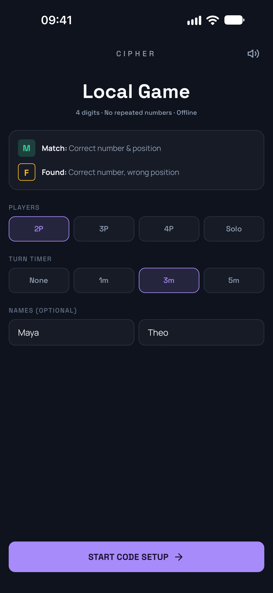
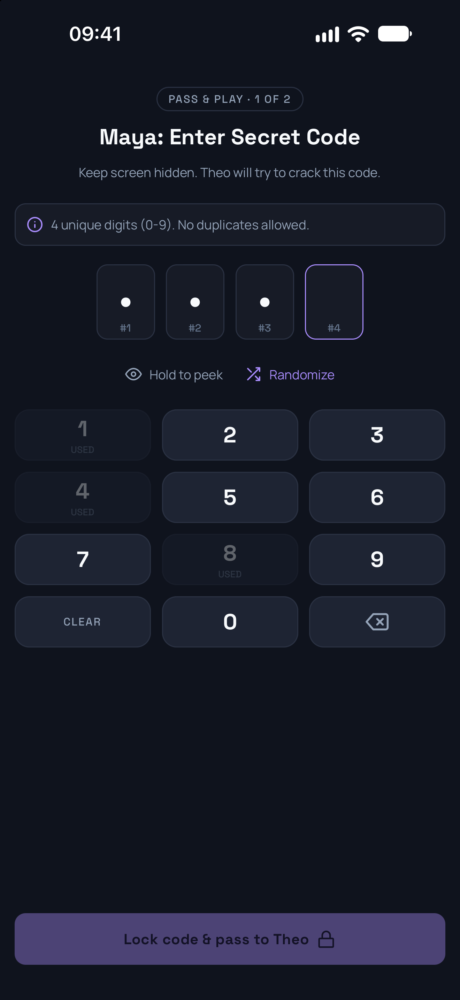
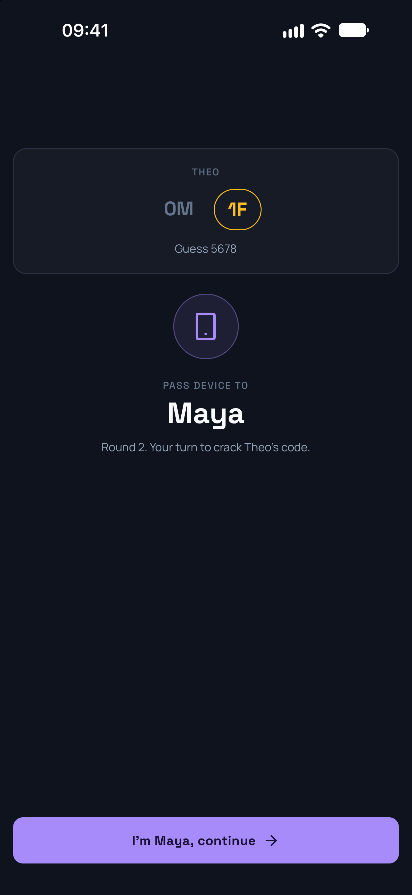
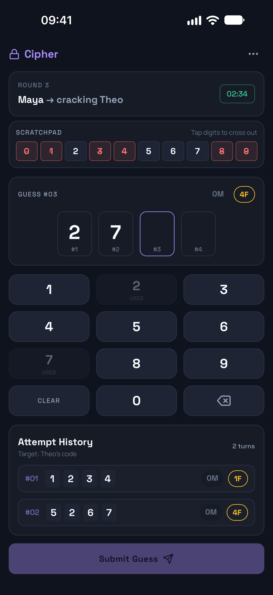
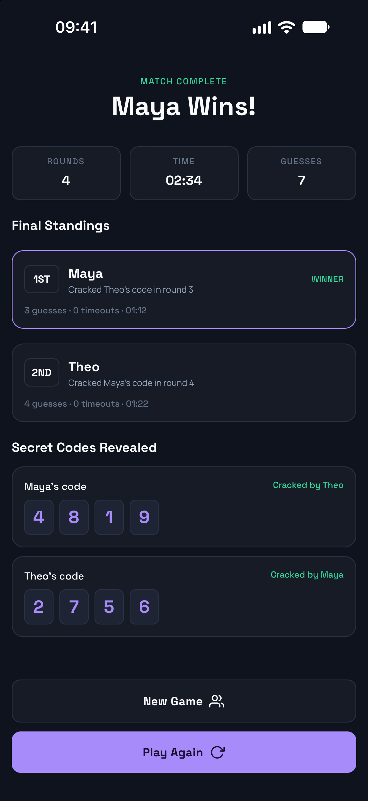

# 1A2B

An offline, pass-and-play code-breaking game for 2–4 players on one phone, plus a Solo puzzle mode.
Crack each other's secret 4-digit codes using `[M] Match` and `[F] Found` clues.

No accounts, no ads, no analytics, no network: everything runs on the device.

<p align="center">
  
  
  
  
  
</p>

## How to play

1. **Pick a mode** in the Lobby: `2P`, `3P`, `4P` or `Solo`, plus an optional turn timer
   (`None`, `1m`, `3m`, `5m`) and player names.
2. **Set your secret code** in private: 4 unique digits (`0123` is fine, `4419` is not).
   Lock it in, then pass the phone on.
3. **Guess in a circle.** Each player cracks the next player's code (P1 → P2 → … → P1).
   Every guess gets a clue right away.
4. **Finish.** Reach `4M` to solve, or give up to go DNF. The match ends when everyone has solved
   or given up, then all codes are revealed.

### Clues

| Clue | Meaning |
|---|---|
| `[M] Match` | Right digit, right position |
| `[F] Found` | Right digit, wrong position |

Example with the secret code `1234`:

| Guess | Result |
|---|---|
| `1234` | `4M 0F` (cracked) |
| `1243` | `2M 2F` |
| `4321` | `0M 4F` |
| `1567` | `1M 0F` |
| `5678` | `0M 0F` |

### Ranking

Players are ranked by the round they solved in (earlier is better), then by total thinking time
(less is better). DNF players share last place.

In **Solo**, the app picks a random code for you to crack and keeps a personal best
(fewest attempts, then fastest time).

## Features

- **Pass-and-play handoff** screens, so nobody sees a code that isn't theirs.
- **Elimination scratchpad** per player, kept between turns.
- **Turn timer**: when it runs out the turn is forfeited and play moves on.
- **Resume**: an unfinished match is saved after every move and can be resumed from the Lobby.
- **Haptics and sound** cues, with a sound toggle.
- **Obsidian** dark theme with bundled fonts (Space Grotesk, Manrope).

## Tech stack

React Native + Expo (TypeScript), Expo Router, NativeWind, Zustand and Jest.

```
src/
  app/          Screens (Expo Router): Lobby, Setup, Game, Results
  components/   Shared UI, including the Handoff screen
  game/         Pure game rules (scoring, turns, ranking) with Jest tests
  store/        Single serializable Zustand store for the whole match
  theme/        Obsidian color palette
```

## Getting started

```bash
npm install
npx expo start       # start the dev server
npm run ios          # build and run on iOS
npm run android      # build and run on Android
```

## Scripts

```bash
npm test             # run Jest tests
npm run typecheck    # TypeScript check
npm run lint         # ESLint
```

## Docs

- [`PRD.md`](PRD.md) holds the full rules, screens and scope.
- [`designs/`](designs/) holds the reference screen designs.
